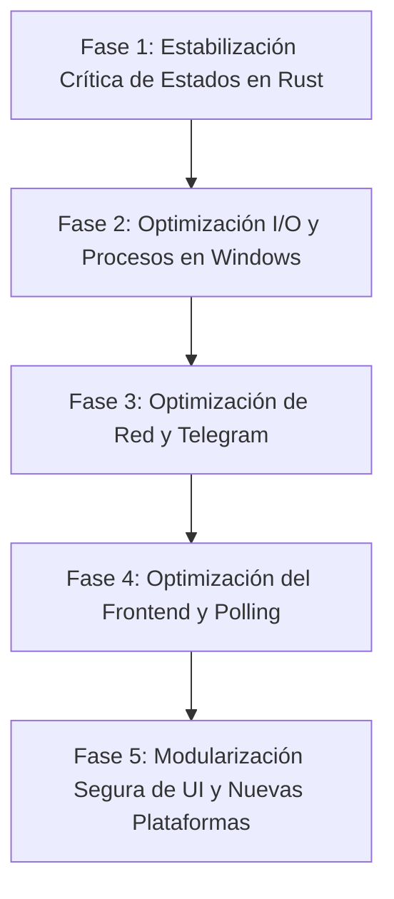

# RAGNAROK — ANÁLISIS DE LIMITACIONES, RIESGOS Y PLAN DE SOLUCIONES

> **Documento Técnico de Diagnóstico y Plan Maestro de Evolución**  
> **Ubicación:** `rust_Ragnarok/`  
> **Fecha:** Octubre 2026  
> **Alcance:** Código Rust (`src/`) y Frontend Web (`ui/`)  

---

## 1. INTRODUCCIÓN Y OBJETIVO

Este documento consolida el diagnóstico técnico integral del ecosistema **Rust** y **Frontend Web** de Ragnarok. Su objetivo es catalogar con máxima precisión todas las limitaciones, cuellos de botella y riesgos técnicos identificados en el código actual, definiendo para cada uno su **solución arquitectónica** y un **plan de ejecución paso a paso** para implementar las mejoras de forma segura y sin regresiones ("cero churuncas").

---

## 2. CATÁLOGO DE LIMITACIONES, RIESGOS Y DEUDA TÉCNICA

### 🔴 GRUPO A: NÚCLEO Y CONCURRENCIA RUST (`src/`)

#### [RIESGO-01] Bloqueo Permanente de Estado en Pipeline por Fallo no Capturado (Alta Severidad)
- **Archivos:** `src/api/pipeline.rs`, `src/crawler/mod.rs`, `src/editor/pipeline.rs`.
- **Diagnóstico:** Al iniciar una fase (por ejemplo, Fase 1 o Fase 2), el endpoint marca el estado como `"running"` dentro de `state.estado_pipeline`. La tarea se ejecuta dentro de un hilo secundario con `tokio::spawn`. Si la lógica interna falla prematuramente debido a un operador `?`, una lectura fallida de carpetas o un error de red antes de alcanzar la línea final de actualización, el estado queda indefinidamente en `"running"`.
- **Impacto:** El panel web queda congelado permanentemente en estado "Ejecutando..." para esa fase, impidiendo que el usuario vuelva a dispararla sin reiniciar el binario de Rust o forzar la detención manual.

#### [RIESGO-02] I/O de Disco Síncrono Bloqueando Hilos Asíncronos de Tokio (Media-Alta Severidad)
- **Archivos:** `src/storage/mod.rs` (`listar_videos_disco`, `contar_lineas`, `leer_metadata`), `src/api/videos.rs`, `src/config.rs`.
- **Diagnóstico:** En `listar_videos_disco`, se utilizan llamadas síncronas de la biblioteca estándar (`std::fs::read_dir`, `std::fs::read_to_string`). Este método es invocado directamente dentro del handler de Axum `listar_videos`.
- **Impacto:** Si la biblioteca de descargas y procesados contiene cientos o miles de carpetas y archivos de video, iterar y parsear cada `metadata.json` sincrónicamente detiene el hilo de trabajo del runtime de Tokio (*worker thread starvation*), provocando latencia o pausas en el resto de peticiones web concurrentes.

#### [RIESGO-03] Sobrecarga de CPU y Latencia por Invocación de PowerShell para Limpieza (Media Severidad)
- **Archivos:** `src/crawler/proceso_limpieza.rs` (`liberar_bloqueos_perfil`).
- **Diagnóstico:** Para verificar y cerrar procesos huérfanos de Chrome o Edge asociados al perfil de usuario, el sistema ejecuta un proceso secundario:
  `powershell -Command "Get-CimInstance Win32_Process | Where-Object ..."`
- **Impacto:** Cada invocación de `powershell.exe` en Windows requiere entre 300 ms y 700 ms para inicializar su entorno .NET, provocando picos de consumo de CPU y retrasos perceptibles durante el arranque y detención de sesiones de scraping o autenticación.

#### [RIESGO-04] Artefactos Visuales y Desfase por Corte Stream-Copy no Alineado a I-Frames (Media Severidad)
- **Archivos:** `src/editor/mod.rs` (`cortar_fragmento`).
- **Diagnóstico:** El motor de recorte utiliza `-c:v copy -c:a copy` para máxima velocidad y consumo cero de RAM. Sin embargo, en video comprimido (H.264/MP4), el corte por copia de flujo únicamente puede segmentar en fotogramas clave (*Keyframes / IDR-Frames*).
- **Impacto:** Si el punto exacto de corte solicitado no coincide con un fotograma clave, el clip resultante puede presentar de 0.5 a 1 segundo de pantalla congelada al inicio mientras el audio avanza, o el clip puede quedar ligeramente más largo/corto que el valor configurado.

#### [RIESGO-05] Sobrecarga de Red y Latencia por Conexión MTProto en Verificación de Estado (Media Severidad)
- **Archivos:** `src/api/telegram_auth.rs` (`estado_sesion`).
- **Diagnóstico:** Cada vez que el panel consulta si la sesión de Telegram está vinculada, la función abre una conexión de red completa por TCP a los centros de datos de Telegram mediante `Client::connect` para verificar `is_authorized()`.
- **Impacto:** Introduce una latencia de 500 ms a 2 segundos en la respuesta de la API y expone al sistema a bloqueos de tasa de peticiones (*FloodWait / rate-limiting*) por parte de Telegram si se consulta repetidamente.

#### [RIESGO-06] Incompletitud en Publicación Multiplataforma (Media Severidad)
- **Archivos:** `src/api/publicacion.rs` (línea 170).
- **Diagnóstico:** Si la plataforma objetivo es distinta de `"telegram"`, la API retorna un error indicando que no está soportada para subida directa nativa.
- **Impacto:** Aunque la interfaz gráfica y los modelos de datos contemplan TikTok, Facebook, YouTube e Instagram, en el backend de Rust únicamente está programado el pipeline de publicación de Telegram.

#### [RIESGO-07] Resolución Dinámica Redundante de Rutas UI en `main.rs` (Baja Severidad)
- **Archivos:** `src/main.rs` (`servir_index`, `servir_css`, `servir_js`).
- **Diagnóstico:** `servir_index` y sus funciones asociadas re-calculan la ruta de la interfaz en cada petición usando `current_dir()` y leen el archivo con `read_to_string` cada vez.
- **Impacto:** Discrepancia potencial si el proceso cambia su directorio de trabajo relativo, además de lecturas redundantes en disco para archivos estáticos que podrían resolverse con `ServeDir` o estar cacheados en memoria.

---

### 🟡 GRUPO B: FRONTEND WEB E INTERFAZ (`ui/`)

#### [RIESGO-08] Monolito Masivo en JavaScript y HTML (Alta Severidad en Mantenibilidad)
- **Archivos:** `ui/logica_panel.js` (3,464 líneas), `ui/panel_control.html` (1,137 líneas).
- **Diagnóstico:** Todo el código JavaScript del panel (reproductores, eventos de arrastre PiP, gestión de modales, temporizadores, lógica de filtrado de videos, llamadas fetch y gestión de estado) se encuentra agrupado en un único archivo sin módulos ES6.
- **Impacto:** Elevado riesgo de regresiones involuntarias ("churuncas") al modificar cualquier función compartida, dificultad para realizar pruebas unitarias y alta complejidad cognitiva al depurar.

#### [RIESGO-09] Polling Continuo sin Detección de Inactividad de Pestaña (Media Severidad)
- **Archivos:** `ui/logica_panel.js` (líneas 52-55).
- **Diagnóstico:** Se mantienen tres intervalos de temporización simultáneos fijos:
  - Cada 1 segundo: reloj del sistema.
  - Cada 3 segundos: `/estado`.
  - Cada 6 segundos: `/api/cookies`.
- **Impacto:** El navegador continúa realizando peticiones constantes incluso si la pestaña está en segundo plano o el usuario tiene el panel minimizado, consumiendo recursos de red local y batería innecesariamente.

#### [RIESGO-10] Reconstrucción Agresiva del DOM con `innerHTML` (Media Severidad)
- **Archivos:** `ui/logica_panel.js`.
- **Diagnóstico:** Las listas de videos, fuentes URL y pendientes se renderizan concatenando cadenas y reemplazando el `innerHTML` del contenedor completo.
- **Impacto:** Pérdida del foco del cursor, reinicio de la posición de scroll al actualizar listas y micro-parpadeos visuales durante la interacción del usuario.

---

## 3. SOLUCIONES TÉCNICAS PROPUESTAS

### Solución a [RIESGO-01]: Guardián de Estado RAII (*Scope Guard / Drop Guard*)
- **Estrategia:** Implementar una estructura RAII en Rust (`FaseGuard`) que implemente el trait `Drop`. Al crearse, registra la fase como `"running"`; al salir de su ámbito (ya sea por finalización exitosa, un operador `?`, un `return` o incluso un `panic`), el destructor `drop` restaura automáticamente el estado de la fase a `"idle"` o `"error"`.
- **Resultado:** Garantía matemática de que ninguna fase quedará atascada en `"running"`.

### Solución a [RIESGO-02]: I/O Asíncrono y Desacople con `spawn_blocking`
- **Estrategia:** Reemplazar las funciones síncronas de `std::fs` en `src/storage/mod.rs` por sus contrapartes asíncronas en `tokio::fs`, o encapsular la enumeración completa de discos pesados dentro de `tokio::task::spawn_blocking(move || { ... })`.
- **Resultado:** El hilo de Axum permanece 100% receptivo sin bloqueos ni retrasos en la respuesta HTTP.

### Solución a [RIESGO-03]: Enumeración Nativa de Procesos en Windows sin PowerShell
- **Estrategia:** Reemplazar la invocación de `powershell.exe` en `proceso_limpieza.rs` por llamadas directas al API de Windows (mediante las crates nativas `sysinfo` o `windows-sys`), o utilizar una llamada rápida a `tasklist /FO CSV` procesada directamente en Rust.
- **Resultado:** Reducción del tiempo de limpieza de 600 ms a menos de 5 ms, sin picos de consumo de CPU.

### Solución a [RIESGO-04]: Modo Híbrido de Corte con FFmpeg ("Smart-Cut")
- **Estrategia:** Mantener el modo `-c copy` ultra rápido como predeterminado para videos estándar, pero añadir una opción configurable en `EdicionConfig` (`corte_exacto: bool` o `reencodear_keyframes: bool`) que permita forzar corte con recodificación acelerada por hardware (NVENC / QuickSync) únicamente cuando el usuario requiera precisión exacta al fotograma.
- **Resultado:** Lo mejor de ambos mundos: velocidad instantánea por defecto y precisión quirúrgica opcional.

### Solución a [RIESGO-05]: Caché de Estado de Sesión en Memoria
- **Estrategia:** No conectar a los servidores de Telegram en cada petición de `/api/telegram/estado_sesion`. Almacenar un flag `sesion_activa: Arc<AtomicBool>` en `AppState` que se actualice:
  1. Durante el arranque del sistema.
  2. Cuando el usuario vincula o desvincula la cuenta.
  3. Tras el resultado de una subida real.
- **Resultado:** Respuesta instantánea (<1 ms) para el panel y cero riesgo de bloqueos por *FloodWait*.

### Solución a [RIESGO-06]: Arquitectura Modular de Publicadores
- **Estrategia:** Diseñar en `src/publisher/` un trait unificado `PublicadorPlataforma` con métodos `publicar_video(...)` y `verificar_credenciales(...)`. Implementar gradualmente los adaptadores correspondientes (Telegram MTProto existente, Facebook Graph API / CDP, YouTube Data API v3, etc.).
- **Resultado:** Expansión limpia y escalable de plataformas sin alterar la lógica de negocio central.

### Solución a [RIESGO-07]: Unificación de Rutas Estáticas en `main.rs`
- **Estrategia:** Utilizar la ruta ya resuelta `ui_path` en `main()` y servir todos los archivos estáticos mediante servicios dedicados de `tower_http::services::ServeFile` o `ServeDir`, eliminando lecturas redundantes con `read_to_string` y asegurando consistencia con `ruta_base`.
- **Resultado:** Mayor robustez y menor consumo de I/O en disco.

### Solución a [RIESGO-08]: Modularización Progresiva de UI en Archivos Especializados
- **Estrategia:** Dividir gradualmente `logica_panel.js` en submódulos temáticos cargados ordenadamente o mediante ES Modules:
  - `ui/js/core_estado.js` (Estado global `App`, inicialización, timers).
  - `ui/js/reproductor_estudio.js` (Estudio, playlist, PiP flotante).
  - `ui/js/gestion_videos.js` (Tabla de videos, filtrado, edición de metadatos).
  - `ui/js/gestion_fuentes.js` (Fuentes y cola de pendientes).
  - `ui/js/publicacion.js` (Lotes, autenticación Telegram y Facebook).
- **Regla Estricta:** Mantener los nombres exactos de funciones y variables globales para garantizar **cero regresiones**.

### Solución a [RIESGO-09]: Pausa Inteligente de Polling con Page Visibility API
- **Estrategia:** Incorporar en el frontend un escuchador del evento `document.addEventListener('visibilitychange')`. Si `document.hidden` es verdadero, pausar los intervalos de consulta; al recuperar el foco de la pestaña, disparar una actualización inmediata y reanudar el ciclo.
- **Resultado:** Ahorro sustancial de peticiones y consumo de batería en el cliente.

### Solución a [RIESGO-10]: Actualización Quirúrgica del DOM
- **Estrategia:** En lugar de reemplazar el contenido completo con `innerHTML = '...'`, actualizar únicamente los nodos que hayan cambiado (modificar clases CSS, atributos `textContent` o insertar/remover elementos específicos por su ID único).
- **Resultado:** Fluidez visual absoluta y preservación permanente del estado de scroll.

---

## 4. PLAN DE EJECUCIÓN PASO A PASO (ROADMAP POR ETAPAS)

### 📍 ETAPA 1: Estabilización Crítica de Estados del Pipeline (Rust)
1. **Paso 1.1:** Crear la estructura `FaseGuard` en `src/state.rs` o `src/api/pipeline.rs` que restaure la fase a `"idle"` al salir de su contexto.
2. **Paso 1.2:** Implementar `FaseGuard` en la ejecución de la Fase 1 (`src/api/pipeline.rs` y `src/crawler/mod.rs`).
3. **Paso 1.3:** Implementar `FaseGuard` en la ejecución de la Fase 2 (`src/editor/pipeline.rs`).
4. **Paso 1.4:** Verificar con `cargo check` y probar detenciones forzadas y simulaciones de error para confirmar que el panel nunca quede trabado.

### 📍 ETAPA 2: Optimización de I/O de Disco y Limpieza en Windows (Rust)
1. **Paso 2.1:** Migrar `listar_videos_disco` en `src/storage/mod.rs` a ejecución con `tokio::task::spawn_blocking` para no bloquear hilos async.
2. **Paso 2.2:** Optimizar `liberar_bloqueos_perfil` en `src/crawler/proceso_limpieza.rs` para verificar procesos huérfanos de Chrome sin sobrecarga de PowerShell.
3. **Paso 2.3:** Validar sintaxis y compilación limpia con `cargo check`.

### 📍 ETAPA 3: Optimización de Red y Telegram (Rust)
1. **Paso 3.1:** Agregar variable de estado en caché `telegram_autorizado: Arc<AtomicBool>` en `AppState`.
2. **Paso 3.2:** Modificar `estado_sesion` en `src/api/telegram_auth.rs` para responder instantáneamente desde la caché en lugar de abrir una conexión TCP a Telegram en cada llamada.
3. **Paso 3.3:** Actualizar la bandera en memoria cuando el usuario solicite/confirme código o cuando una subida reporte error de autorización.

### 📍 ETAPA 4: Optimización del Frontend y Control de Polling (UI)
1. **Paso 4.1:** Incorporar `Page Visibility API` en `ui/logica_panel.js` para suspender el polling periódico cuando la pestaña no esté visible.
2. **Paso 4.2:** Reutilizar el canal de Server-Sent Events (SSE) para reflejar cambios de estado en tiempo real, reduciendo la dependencia de `/estado` por sondeo.
3. **Paso 4.3:** Verificar que todos los controles, tablas y reproductores conserven exactamente el mismo comportamiento visual y funcional.

### 📍 ETAPA 5: Modularización Gradual y Nuevas Plataformas (Futuro)
1. **Paso 5.1:** Diseñar la arquitectura modular de `ui/logica_panel.js` manteniendo 100% de compatibilidad con las funciones globales actuales.
2. **Paso 5.2:** Diseñar el trait común de publicadores en `src/publisher/` para preparar la integración de Facebook y YouTube.

---

## 5. CRITERIOS DE ACEPTACIÓN Y REGLAS DE NO-REGRESIÓN

- **Regla de los 300 renglones:** Ningún archivo `.rs` creado o modificado podrá sobrepasar las 300 líneas de código.
- **Cero Regresiones ("Cero Churuncas"):** Ningún control de interfaz (`<select>`, modales, botones, reproductores) será eliminado ni reemplazado.
- **Compilación Segura:** Cada paso debe ser verificado con `cargo check` sin generar advertencias ni errores.
- **Persistencia Garantizada:** Todos los cambios mantendrán compatibilidad absoluta con los esquemas de configuración JSON existentes en disco.
