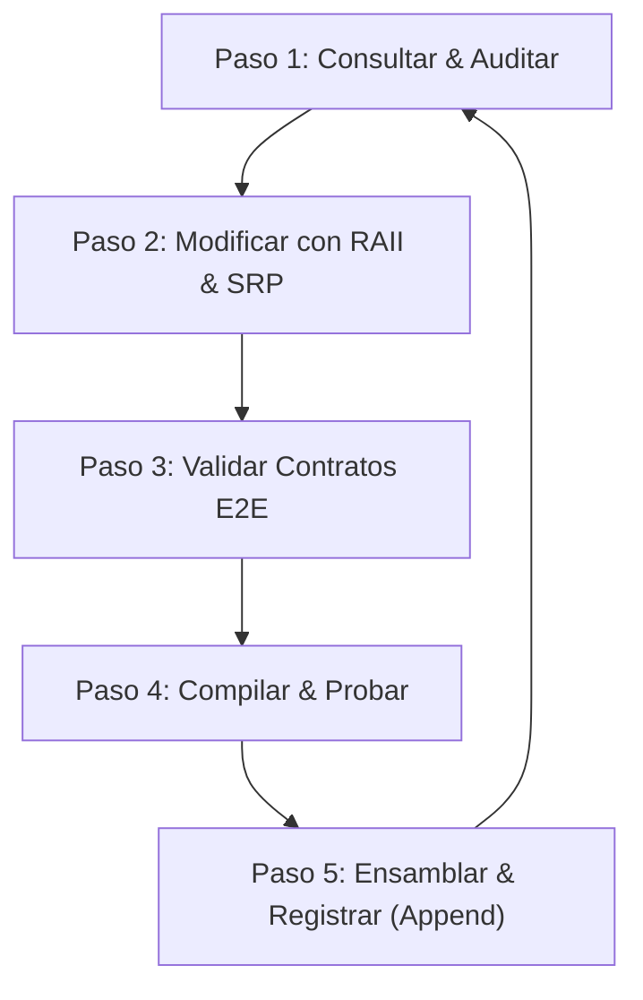

# PLAN ITERATIVO DE OPTIMIZACIÓN, RENTABILIDAD, RENDIMIENTO Y VERIFICACIÓN CONTINUA
## Ecosistema Ragnarok — Arquitectura Full-Stack Nativa (Rust + Vanilla JS/HTML/CSS)

Este documento establece el protocolo formal de ingeniería para auditar, iterar, probar y optimizar continuamente el sistema Ragnarok bajo los principios de máxima rentabilidad de recursos, rendimiento extremo (<30 MB RAM) y cero regresiones (*Cero Churuncas*).

---

## 1. PILARES DE INGENIERÍA Y CRITERIOS DE RENTABILIDAD

| Pilar | Definición Técnica | Métrica / Garantía |
| :--- | :--- | :--- |
| **Rentabilidad de Red** | Cero descargas redundantes, saltado de URLs ya procesadas en `historial_urls.txt` y streaming HTTP 206 parcial. | 0% consumo de ancho de banda duplicado. |
| **Rendimiento de Hardware** | Arquitectura Zero-RAM. Transmisión directa de disco a socket por chunks de 512KB vía MTProto; FFmpeg en `stream-copy` sin re-encoding. | <30 MB RAM en reposo / <60 MB bajo carga. |
| **Protección Anti-Baneos** | Jitter orgánico estocástico (2.2s a 3.8s) en scrolls de Facebook CDP, pausas de seguridad y MTProto oficial en Rust sin navegadores. | 0 bloqueos por patrones robóticos o saturación. |
| **Ciclo de Vida (0 Zombies)** | Todo subproceso (`yt-dlp`, `ffmpeg`, `Chromium`) implementa RAII estricto con `.kill_on_drop(true)` y `Drop` con árbol `taskkill /F /T`. | 0 procesos huérfanos en Windows Task Manager. |
| **Modularidad y SRP** | 14 componentes atómicos HTML, 11 submódulos JS especializados y todos los archivos `.rs` bajo la **regla de los 300 renglones**. | Alta cohesión, bajo acoplamiento y mantenimiento ágil. |

---

## 2. MATRIZ DE CONECTIVIDAD DE CONTRATOS (END-TO-END)

Esta matriz vincula cada control de la interfaz gráfica con su función de frontend, su handler en Rust y su almacenamiento físico:

### A. Vistas Principales y Pipeline
| Elemento UI / Botón | Módulo JS / Función | Endpoint Rust (Axum) | Archivo / Persistencia | Estado |
| :--- | :--- | :--- | :--- | :--- |
| **Fase 1: Iniciar** | `03_pipeline_fases.js: ejecutarFase(1)` | `POST /ejecutar/1` | `src/api/pipeline.rs` | ✅ Conectado |
| **Fase 1: Detener** | `03_pipeline_fases.js: detenerFase(1)` | `POST /detener/1` | `src/api/pipeline.rs` | ✅ Conectado |
| **Fase 2: Iniciar** | `03_pipeline_fases.js: ejecutarFase(2)` | `POST /ejecutar/2` | `src/api/pipeline.rs` | ✅ Conectado |
| **Fase 2: Detener** | `03_pipeline_fases.js: detenerFase(2)` | `POST /detener/2` | `src/api/pipeline.rs` | ✅ Conectado |
| **Fase 3: Iniciar** | `03_pipeline_fases.js: ejecutarFase(3)` | `POST /ejecutar/3` | `src/api/pipeline.rs` | ✅ Conectado |
| **Fase 4: Lotes Telegram** | `09_publicacion_tg.js: iniciarPublicacionLoteTelegram()` | `POST /api/publicar/lote/telegram` | `datos_persistencia/cola_publicacion_telegram.json` | ✅ Conectado |
| **Fase 4: Detener Lote** | `09_publicacion_tg.js: detenerLoteTelegram()` | `POST /api/publicar/lote/detener` | `src/api/publicacion.rs` | ✅ Conectado |
| **Pipeline Completo** | `03_pipeline_fases.js: ejecutarPipelineCompleto()` | `POST /ejecutar/1` | Secuencia 1 → 2 → 3 | ✅ Conectado |
| **Eventos en Vivo (SSE)** | `02_eventos_sse.js: EventSource` | `GET /eventos` | `src/api/events.rs` | ✅ Conectado |

### B. Gestión de Fuentes y Cola de Pendientes
| Elemento UI / Botón | Módulo JS / Función | Endpoint Rust (Axum) | Archivo / Persistencia | Estado |
| :--- | :--- | :--- | :--- | :--- |
| **Agregar Fuente** | `04_gestion_fuentes.js: agregarFuenteURL()` | `POST /fuentes` | `fuentes_facebook.txt` | ✅ Conectado |
| **Recargar Fuentes** | `04_gestion_fuentes.js: cargarFuentesDesdeServidor()` | `GET /fuentes` | `fuentes_facebook.txt` | ✅ Conectado |
| **Alternar Fuente** | `04_gestion_fuentes.js: toggleFuente()` | `POST /fuentes/toggle` | `fuentes_facebook.txt` | ✅ Conectado |
| **Eliminar Fuente** | `04_gestion_fuentes.js: eliminarFuenteURL()` | `DELETE /fuentes/:url` | `fuentes_facebook.txt` | ✅ Conectado |
| **Agregar Pendiente** | `05_cola_pendientes.js: agregarEnlacePendiente()` | `POST /pendientes` | `cola_pendientes.txt` | ✅ Conectado |
| **Recargar Pendientes**| `05_cola_pendientes.js: cargarPendientesDesdeServidor()` | `GET /pendientes` | `cola_pendientes.txt` | ✅ Conectado |
| **Descarga Directa** | `03_pipeline_fases.js: ejecutarDescargaUnicamente()` | `POST /ejecutar/descargar`| `src/downloader/mod.rs` | ✅ Conectado |

### C. Estudio Cinema, Editor y Recorte
| Elemento UI / Botón | Módulo JS / Función | Endpoint Rust (Axum) | Archivo / Persistencia | Estado |
| :--- | :--- | :--- | :--- | :--- |
| **Lista de Videos** | `06_galeria_videos.js: cargarGaleriaDesdeServidor()` | `GET /api/videos` | `descargas/` / `metadata.json` | ✅ Conectado |
| **Guardar Metadatos** | `08_estudio_editor.js: guardarMetadatosActivo()` | `POST /api/videos/:id/metadata` | `descargas/<id>/metadata.json` | ✅ Conectado |
| **Cortar en Partes** | `08_estudio_editor.js: ejecutarRecorteEstudio()` | `POST /api/videos/recortar` | `procesados/<id>/part_*.mp4` | ✅ Conectado |
| **Eliminar Video** | `06_galeria_videos.js: eliminarVideo()` | `DELETE /api/videos/:id` | Purga física de disco | ✅ Conectado |
| **Publicar Telegram** | `08_estudio_editor.js: confirmarPublicacionDirecta()` | `POST /api/publicar/individual` | `telegram.session` | ✅ Conectado |
| **Publicar Facebook** | `08_estudio_editor.js: confirmarPublicacionDirecta()` | `POST /api/publicar/individual` | Perfil Chromium CDP | ⏳ Espera CDP |
| **Publicar YouTube/TikTok** | `08_estudio_editor.js: confirmarPublicacionDirecta()` | Guardas defensivas en UI | `src/publisher/traits.rs` | ⏳ Espera API |

### D. Autenticación y Sesiones
| Elemento UI / Botón | Módulo JS / Función | Endpoint Rust (Axum) | Archivo / Persistencia | Estado |
| :--- | :--- | :--- | :--- | :--- |
| **Estado Cookies** | `04_gestion_fuentes.js: cargarEstadoCookies()` | `GET /api/cookies` | `src/api/auth.rs` | ✅ Conectado |
| **Estado Sesión TG** | `09_publicacion_tg.js: verificarEstadoSesionTelegram()` | `GET /api/telegram/estado_sesion` | `telegram.session` | ✅ Conectado |
| **Solicitar Código TG**| `09_publicacion_tg.js: solicitarCodigoTelegram()` | `POST /api/telegram/solicitar_codigo` | MTProto oficial | ✅ Conectado |
| **Confirmar Código TG**| `09_publicacion_tg.js: confirmarCodigoTelegram()` | `POST /api/telegram/confirmar_codigo` | `telegram.session` | ✅ Conectado |
| **Confirmar 2FA TG** | `09_publicacion_tg.js: confirmarPasswordTelegram()` | `POST /api/telegram/confirmar_password` | `telegram.session` | ✅ Conectado |
| **Abrir Nav. Facebook**| `10_auth_facebook.js: abrirNavegadorFacebook()` | `POST /api/facebook/iniciar_sesion` | Chromium CDP | ✅ Conectado |
| **Capturar Sesión FB** | `10_auth_facebook.js: capturarSesionFacebook()` | `POST /api/facebook/capturar_sesion` | `cookies_facebook.json` | ✅ Conectado |
| **Cerrar Nav. Facebook**| `10_auth_facebook.js: cerrarNavegadorFacebookManual()` | `POST /api/facebook/cerrar_navegador` | Proceso Chromium | ✅ Conectado |

### E. Configuración Global y Scheduler
| Elemento UI / Botón | Módulo JS / Función | Endpoint Rust (Axum) | Archivo / Persistencia | Estado |
| :--- | :--- | :--- | :--- | :--- |
| **Cargar Config** | `11_configuracion.js: abrirConfig()` | `GET /config` | `parametros_globales.json` | ✅ Conectado |
| **Guardar Config** | `11_configuracion.js: guardarConfig()` | `POST /config` | `parametros_globales.json` | ✅ Conectado |
| **Aplicar Velocidad** | `11_configuracion.js: aplicarVel()` | `POST /config` | `edicion.factor_velocidad` | ✅ Conectado |
| **Scheduler Tareas** | `11_configuracion.js: addTarea()` / `guardarProg()` | Cola local en memoria | Integración demonio cron | ⏳ Espera Cron |

---

## 3. PROTOCOLO DE ITERACIÓN CONTINUA (LOOP DE 5 PASOS)

Para cada iteración de optimización y ajuste en el proyecto, se ejecuta estrictamente el siguiente ciclo:

### Paso 1: Consultar & Auditar (Inspección Previa)
- Revisar métricas de memoria y procesos en ejecución (`taskkill /F /IM chrome.exe` si hay pruebas pendientes).
- Verificar que no existan llamadas síncronas bloqueantes (`std::fs` o `std::thread::sleep`) dentro de contextos asíncronos.
- Comprobar conteo de líneas de archivos `.rs` para no superar los 300 renglones.

### Paso 2: Modificar con RAII & SRP (Implementación Limpia)
- Modificar componentes atómicos específicos en `ui/componentes/` o submódulos en `ui/js/`.
- Garantizar que cualquier nuevo subproceso incluya `.kill_on_drop(true)`.
- Reemplazar lecturas síncronas por equivalentes asíncronos en Tokio o envolver con `tokio::task::spawn_blocking`.
- Preservar invariantes de persistencia en disco: nada hardcodeado en memoria efímera.

### Paso 3: Validar Contratos de Extremo a Extremo
- Verificar que los nombres de campos en `serde_json` (Rust) y `fetch` (JS) tengan correspondencia exacta.
- Asegurar que no se renombren IDs de HTML ni clases de CSS sin reflejarlas en todos los scripts asociados.
- Comprobar que las plataformas o módulos en desarrollo mantengan avisos de espera explícitos y botones deshabilitados.

### Paso 4: Compilar & Probar (Verificación Mecánica)
- Ejecutar `cargo check` verificando **0 errores y 0 warnings**.
- Ejecutar suite de pruebas unitarias con `cargo test` si aplica.
- Validar la sintaxis de los scripts modificados.

### Paso 5: Ensamblar & Registrar (Mantenimiento Documental)
- Ejecutar `python ui/ensamblar_ui.py` para regenerar el documento maestro `ui/panel_control.html`.
- Anexar el registro de cambios a `analisis/ANALISIS_LIMITACIONES_Y_SOLUCIONES.md` en **estricto modo APPEND** (`Append: true`).

---

## 4. CHECKLIST DE CERTIFICACIÓN PARA CADA ITERACIÓN

Antes de dar por finalizada una iteración y realizar `git commit` / `git push`:

- [ ] **RAM < 30 MB:** No se cargan buffers completos de video en RAM; los chunks de streaming son acotados.
- [ ] **0 Zombies:** Todo proceso hijo tiene RAII activo y se garantiza su recolección ante cancelaciones.
- [ ] **Regla 300 Renglones:** Ningún archivo `.rs` supera las 300 líneas de código.
- [ ] **Sin Hardcoding:** Las configuraciones se leen y escriben dinámicamente en disco.
- [ ] **Honestidad de UI:** Cero simulaciones o toasts falsos; elementos en desarrollo indican "En espera".
- [ ] **DOM Acotado:** Log deslizante limitado a 200 nodos; timers pausados con Page Visibility API.
- [ ] **Cargo Check Limpio:** 0 warnings del compilador de Rust.
- [ ] **Ensamblado UI:** `panel_control.html` generado correctamente desde `ui/componentes/`.
- [ ] **Documentación Append:** `ANALISIS_LIMITACIONES_Y_SOLUCIONES.md` actualizado sin sobreescrituras.
